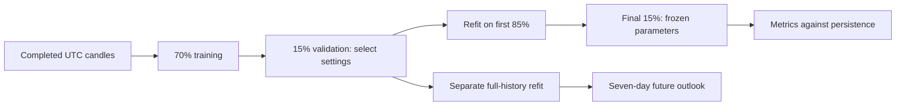

# Bitcoin Forecasting: Comparing Statistical and Machine Learning Models

A reproducible daily BTC-USD forecasting study and local Streamlit dashboard. It asks a concrete question: **do ARIMA, Random Forest, or LSTM forecasts beat simply predicting the last observed price?**

The project compares the same seven future closing prices at the same forecast origins. It separates model selection, held-out evaluation, and a full-history future outlook.


## Measured results

The saved Yahoo Finance snapshot contains **1,825 completed daily candles**, from **2021-10-16 to 2026-10-14**. The test partition is 2026-01-14 to 2026-10-14; 39 complete seven-day blocks score 273 targets through 2026-10-13. The final incomplete block is excluded.

| Model | Test MAE (USD) | Test RMSE (USD) | MAE improvement vs baseline |
|---|---:|---:|---:|
| Last price | 2,482.47 | 3,665.98 | 0.00% |
| Random Forest | 5,038.28 | 6,695.67 | -102.95% |
| ARIMA | 2,482.47 | 3,665.98 | 0.00% |
| LSTM | 9,063.11 | 9,830.60 | -265.08% |

**The more complex models did not beat persistence on this holdout.** Validation selected ARIMA(0,1,0), a random walk without drift, which has the same point forecast as the last-price baseline. Negative improvement means higher error. This finding is part of the project, not a result hidden by selecting a flattering test window.

Read the [full measured report](docs/benchmark/benchmark.md), including per-horizon plots, selected parameters, data fingerprint, timing, and limitations. Results describe this fixed snapshot and protocol; they are not a prediction of trading performance.

## Run locally

Use **64-bit Python 3.11**. Windows CPU is the verified platform. The dependency versions are deliberately pinned; do not substitute Python 3.12+ or upgrade TensorFlow independently.

```powershell
py -3.11 -m venv .venv
.\.venv\Scripts\python.exe -m pip install -r requirements.txt
.\.venv\Scripts\python.exe -m streamlit run BTCPredictionModel.py
```

Open the URL printed by Streamlit, normally `http://localhost:8501`. Activation is not required. If another Streamlit app already uses that port, append `--server.port 8502`.

1. Click **Refresh daily data** to download a five-year daily snapshot, or import a previously saved CSV.
2. Leave the defaults selected and click **Run benchmark**. The reference run took approximately two minutes on the tested machine; hardware and data length affect timing.
3. Explore **Model Comparison**, **Forecast**, and **Methodology**. Changing chart overlays does not retrain the models.
4. On subsequent launches, click **Load matching saved run** to reopen results without training. The data fingerprint and model settings must match.

Data loading is explicit. Startup never makes a network request. Yahoo rate limits or connection failures produce an actionable error; the app does not substitute a different interval or synthetic prices. A failed refresh keeps the previous snapshot visibly selected.

The existing project environment already works with the same launch command. The original script is preserved locally under ignored `artifacts/original/`.

### Dependency files

- `requirements-direct.txt`: the application's direct dependencies.
- `requirements-lock-windows.txt`: pinned transitive versions from the tested Windows environment, used as constraints by `requirements.txt`.
- `requirements-demo.txt`: optional local video encoder, needed only to rebuild the walkthrough.

The lock originated with the original project environment. Unused packages listed in it are constraints, not installation requests. The new app does not depend on `pmdarima`, standalone Keras imports, seaborn, or a GPU. A Linux CI workflow is included; its hosted execution is not part of the local verification.

## Reproduce an experiment from the command line

```powershell
.\.venv\Scripts\python.exe -m btc_forecast.cli fetch
.\.venv\Scripts\python.exe -m btc_forecast.cli evaluate
.\.venv\Scripts\python.exe -m btc_forecast.cli show <saved-run-directory>
.\.venv\Scripts\python.exe -m btc_forecast.cli report <saved-run-directory>
```

`fetch` writes a timestamped CSV and JSON sidecar into `data/cache/`. `evaluate` uses the latest cached snapshot and saves a new directory in `artifacts/runs/`. To repeat the exact reference data, use the saved run's `data.csv`:

```powershell
.\.venv\Scripts\python.exe -m btc_forecast.cli evaluate --data <saved-run-directory>\data.csv --epochs 12 --trees 200 --seed 42
```

To run a smaller experiment, use `--models "Random Forest" ARIMA`; the last-price baseline is always included. Smaller epoch/tree settings are different experiments and should not be compared as reproductions of the reference run.

Each completed run contains:

| File | Content |
|---|---|
| `data.csv`, `data.json` | Exact input snapshot and source metadata |
| `predictions.csv` | Model, forecast origin, target date, horizon, actual price, predicted price |
| `metrics.csv` | Overall and per-horizon MAE/RMSE, baseline improvement, observation counts |
| `forecasts.csv` | Separate full-history seven-day forecasts; ARIMA intervals where available |
| `tuning.csv` | Every candidate's validation MAE or failure reason |
| `manifest.json` | Split dates, seed, settings, fingerprint, package versions, durations, and model warnings |

CSV data needs `Datetime,Open,High,Low,Close,Volume`. Timestamps must identify consecutive midnight UTC days, prices must be positive and form valid OHLC candles, and volume must be nonnegative. At least 240 completed observations are required. Today's unfinished candle is removed. Missing days, duplicate timestamps, missing prices, and future-dated candles are rejected rather than imputed. Imported files are explicitly labelled as having unverified provenance.

The local data and full run directories are Git-ignored. The compact report and aggregate metrics are included in the repository. Share the fixed run folder separately for exact reproduction: downloading Yahoo data on another day creates a new experiment.

## Evaluation design



- **Targets:** closing prices at horizons 1–7 after each origin. RF and LSTM predict all seven directly; no recursively frozen indicators or probability-to-price conversion.
- **Features:** causal returns, rolling volatility, moving average and RSI; RF additionally uses close lags, MACD, Bollinger width, log-volume change and weekday. Indicator warm-up rows are dropped. Constant prices and zero-volume days have defined handling.
- **LSTM:** 60 days × five features; one recurrent layer, a dense layer, and seven outputs. Candidates have 32 or 64 recurrent units. Twelve epochs by default, chronological batches, seeded deterministic TensorFlow operations. Feature and target scalers are fitted only on the history supplied to training.
- **Random Forest:** multi-output regression, 200 trees by default, depth 6 or 12, minimum leaf size 2, fixed seed.
- **ARIMA:** non-seasonal orders (0,1,0), (1,1,0), (0,1,1), (1,1,1), selected by validation MAE. Nonconverged candidates fail explicitly. No artificial noise is added.
- **Selection:** use the first 70% to train candidates and the following 15% to select by overall MAE. Training samples are built only from their training slice, so seven-day labels cannot cross a split boundary.
- **Testing:** refit selected settings on the first 85%, then forecast complete, non-overlapping seven-day blocks in the final 15%. Model parameters stay fixed. Each later origin receives the intervening observed history; ARIMA filters these observations without coefficient refitting.
- **Outlook:** separately refit selected settings on all completed history. Its dates begin after the snapshot's final candle, even when the snapshot is old. Outlook prices are not held-out test scores.

Only ARIMA displays a model-based 95% prediction interval. No uncertainty band is invented for RF or LSTM. Baseline-relative percentages are undefined when the baseline error is zero; those values remain missing.

## Architecture and checks

`BTCPredictionModel.py` preserves the old command and delegates to the UI. Inside `btc_forecast`, `data` owns validation/snapshots, `features` owns causal inputs, `models` implements `fit(history)` and `forecast(history)`, `evaluation` owns the protocol and output tables, and `app`/`charts` present them. Model modules have no Streamlit dependency. `cli` and the dashboard use the same evaluation runner.

```powershell
.\.venv\Scripts\python.exe -m pip check
.\.venv\Scripts\python.exe -m unittest discover -s tests -v
```

Tests cover data failure modes, completed-candle filtering, fingerprint round trips, causal features, split-boundary labels, forecast timestamps, fixed ARIMA coefficients and native intervals, every model's small-data training/forecast path, saved results, and Streamlit rerun/invalidation behavior. They use synthetic fixtures only and make no market-data requests.

Reproducibility is assessed on exact saved predictions, not just rounded headline metrics. Compare with floating-point tolerance; different hardware and TensorFlow kernels can produce small differences. See [verification notes](docs/verification.md) for what was actually checked.

## Demo and limitations

See the [walkthrough guide](docs/demo.md) and dashboard captures in `docs/screenshots/`. The locally generated captioned walkthrough is `artifacts/demo/bitcoin-forecasting-walkthrough.mp4`.

This is a bounded forecasting study, not a production trading system. One holdout and a small search grid do not establish performance in other regimes. RF cannot extrapolate beyond training target values; LSTM settings are deliberately modest. Avoid repeatedly tuning against this reported test set. Future research should use new data or a predefined walk-forward protocol, explore return-based targets, and compare improvements against the same baseline.

Live hosting, intraday data, trading execution, and additional model families are intentionally outside this version.
