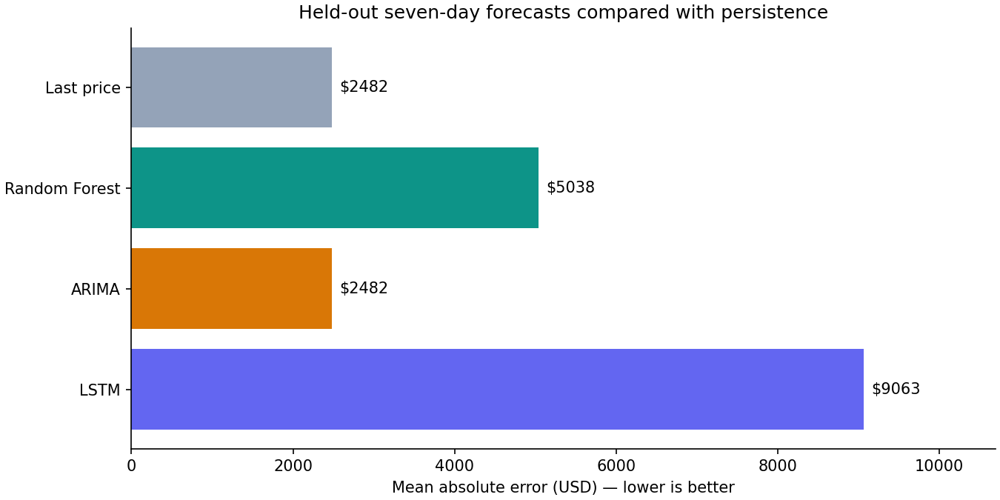
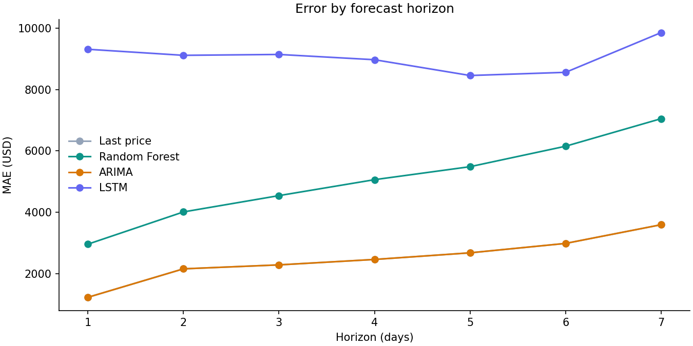
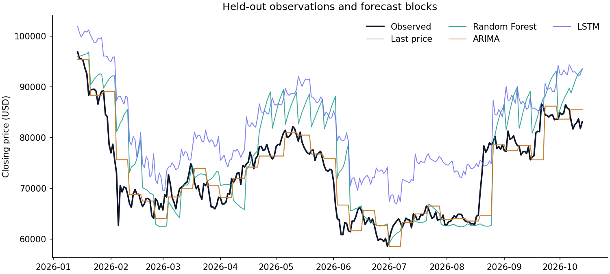

# Measured Bitcoin forecasting benchmark

Generated from run `20261016T041636624217Z-c47b2dc512` at 2026-10-16T04:16:36.580513+00:00.

Source: **Yahoo Finance via yfinance**. 1,825 completed UTC daily candles, 2021-10-16 through 2026-10-14. Retrieved 2026-10-16T04:14:25.661463+00:00.

Data SHA-256: `72977dc46866d33cabe3e9de59d8bf298f6e542583f5d4c8053aa45618a9516f`.

Training ends 2025-04-14; validation 2025-04-15–2026-01-13; test partition 2026-01-14–2026-10-14.

The test contains 39 origins, seven days apart. Scored targets run from 2026-01-14 through 2026-10-13; 1 trailing day(s) are excluded because the final block is incomplete.

| Model | MAE (USD) | RMSE (USD) | MAE improvement vs baseline |
|---|---:|---:|---:|
| Last price | 2,482.47 | 3,665.98 | +0.00% |
| Random Forest | 5,038.28 | 6,695.67 | -102.95% |
| ARIMA | 2,482.47 | 3,665.98 | +0.00% |
| LSTM | 9,063.11 | 9,830.60 | -265.08% |

Positive improvement means lower error. Negative means worse; no trading returns are inferred.







## Selected settings

```json
{
  "Last price": {},
  "Random Forest": {
    "max_depth": 6
  },
  "ARIMA": {
    "order": [
      0,
      1,
      0
    ]
  },
  "LSTM": {
    "units": 64
  }
}
```

Seed: 42; LSTM epochs: 12; RF trees: 200; runtime: 118.0 seconds on Windows-10-10.0.26200-SP0.

Selection minimizes validation MAE over all seven horizons. Test models are refitted on training plus validation, then evaluated with fixed parameters. Forecast inputs advance to each origin; ARIMA filters new observations without re-estimating coefficients. Future outlooks are separate full-history refits and are not included in these scores.

## Interpretation and limits

Read model performance relative to the last-price baseline. If ARIMA selects (0,1,0), it is a random walk without drift and produces the same point forecast as persistence. Random Forest price regression cannot extrapolate beyond its training target range; regime changes are a plausible contributor to weak results. LSTM performance depends on representation, capacity, and training duration. These explanations are hypotheses, not causal findings from this experiment.

This is a single chronological holdout and a small, predefined validation search. Absolute USD errors vary with the price regime. No claim is made about profitability, calibrated uncertainty for RF/LSTM, or generalization to other assets. Future changes should be evaluated on new data or a preregistered walk-forward design rather than repeatedly optimizing this test set.

## Reproduction

Run `python -m btc_forecast.cli evaluate --data <saved-run>/data.csv` with the configuration recorded in `manifest.json`. Defaults reproduce the standard 12-epoch, 200-tree, seed-42 study. A later download changes the dataset and is a new experiment. Exact snapshots and full outputs are retained locally under ignored `artifacts/runs/`; share the run directory separately when exact reproduction is needed.

Package versions and per-model durations are recorded in the run manifest. CPU runs with the pinned environment should agree within small floating-point tolerances; cross-platform TensorFlow training may differ.
